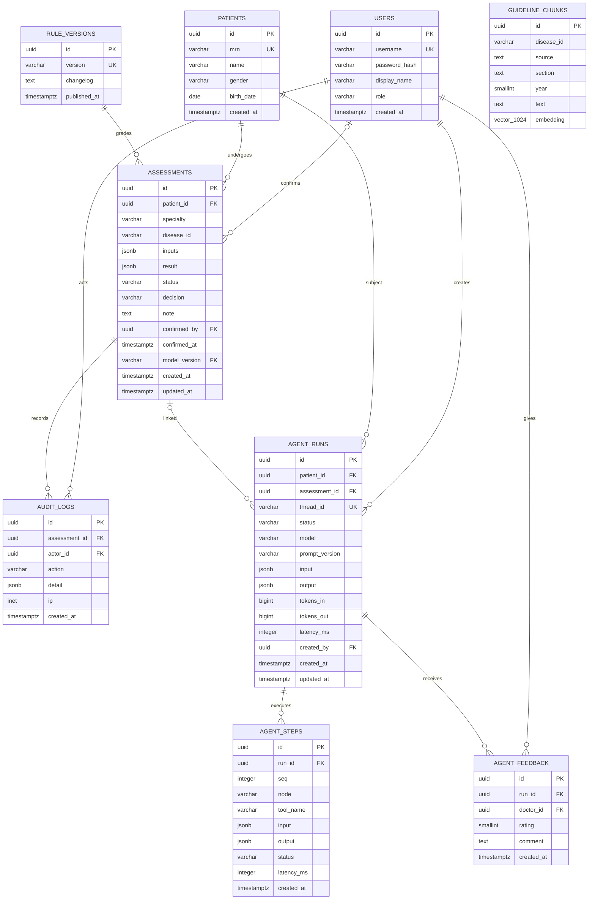
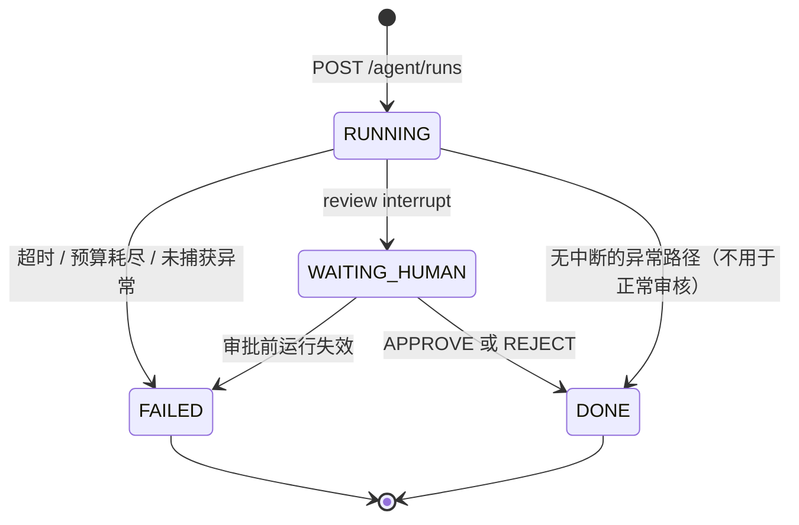

# MedRisk 数据模型

状态：设计基线（执行步骤 1）  
数据库：PostgreSQL 16 + pgvector  
迁移：Alembic；所有时间使用 UTC `timestamptz`，ID 由应用生成 UUID v4。

## 1. ER 图



说明：

- `AGENT_RUNS.assessment_id` 可空。run 可以从既有评估发起，也可以在医生批准后才创建评估并回填。
- `GUIDELINE_CHUNKS` 不对 `disease_id` 建外键：知识库可独立于病种注册表演进，检索时按注册表校验。
- `RULE_VERSIONS.version` 为自然唯一键；`ASSESSMENTS.model_version` 外键指向它，确保每次评估可追溯到规则发布版本。
- 图中 `vector_1024` 是 Mermaid 可读写法，实际列类型为 `vector(1024)`。

## 2. 表与约束

### users

| 列 | 类型 | 约束 |
| --- | --- | --- |
| id | uuid | PK |
| username | varchar(64) | NOT NULL, UNIQUE |
| password_hash | varchar(255) | NOT NULL, Argon2id |
| display_name | varchar(100) | NOT NULL |
| role | varchar(16) | NOT NULL, CHECK IN ('DOCTOR','ADMIN') |
| created_at | timestamptz | NOT NULL, default now() |

### patients

| 列 | 类型 | 约束 |
| --- | --- | --- |
| id | uuid | PK |
| mrn | varchar(32) | NOT NULL, UNIQUE |
| name | varchar(100) | NOT NULL |
| gender | varchar(16) | NOT NULL, CHECK IN ('MALE','FEMALE','OTHER','UNKNOWN') |
| birth_date | date | NOT NULL |
| created_at | timestamptz | NOT NULL, default now() |

演示环境仅使用合成患者。`mrn` 用于搜索与去重，不发给外部模型。

### assessments

| 列 | 类型 | 约束 |
| --- | --- | --- |
| id | uuid | PK |
| patient_id | uuid | NOT NULL, FK patients, ON DELETE RESTRICT |
| specialty | varchar(32) | NOT NULL |
| disease_id | varchar(64) | NOT NULL |
| inputs | jsonb | NOT NULL |
| result | jsonb | NOT NULL |
| status | varchar(16) | NOT NULL, CHECK IN ('PENDING','CONFIRMED') |
| decision | varchar(64) | NULL |
| note | text | NULL |
| confirmed_by | uuid | NULL, FK users, ON DELETE RESTRICT |
| confirmed_at | timestamptz | NULL |
| model_version | varchar(64) | NOT NULL, FK rule_versions(version), ON DELETE RESTRICT |
| created_at | timestamptz | NOT NULL, default now() |
| updated_at | timestamptz | NOT NULL, default now() |

业务校验：`status = CONFIRMED` 时 `confirmed_by`、`confirmed_at` 必填；`PENDING` 时二者必须为空。由服务层保证，迁移中再加 CHECK 约束。

### audit_logs

| 列 | 类型 | 约束 |
| --- | --- | --- |
| id | uuid | PK |
| assessment_id | uuid | NOT NULL, FK assessments, ON DELETE RESTRICT |
| actor_id | uuid | NOT NULL, FK users, ON DELETE RESTRICT |
| action | varchar(64) | NOT NULL |
| detail | jsonb | NOT NULL, 已脱敏 |
| ip | inet | NULL |
| created_at | timestamptz | NOT NULL, default now() |

追加写，不提供更新/删除 API。建议生产环境对应用数据库角色撤销该表的 UPDATE/DELETE 权限。

### rule_versions

| 列 | 类型 | 约束 |
| --- | --- | --- |
| id | uuid | PK |
| version | varchar(64) | NOT NULL, UNIQUE |
| changelog | text | NOT NULL |
| published_at | timestamptz | NOT NULL, default now() |

`version` 示例：`rules-2026.11.1`。不得随意修改已发布的阈值；变更必须新增版本并登记 changelog。

### agent_runs

| 列 | 类型 | 约束 |
| --- | --- | --- |
| id | uuid | PK |
| patient_id | uuid | NOT NULL, FK patients, ON DELETE RESTRICT |
| assessment_id | uuid | NULL, FK assessments, ON DELETE RESTRICT |
| thread_id | varchar(64) | NOT NULL, UNIQUE，对应 LangGraph thread |
| status | varchar(20) | NOT NULL, CHECK IN ('RUNNING','WAITING_HUMAN','DONE','FAILED') |
| model | varchar(100) | NOT NULL |
| prompt_version | varchar(64) | NOT NULL |
| input | jsonb | NOT NULL, 已脱敏 |
| output | jsonb | NULL，最终草稿/错误/拒绝原因 |
| tokens_in | bigint | NULL |
| tokens_out | bigint | NULL |
| latency_ms | integer | NULL |
| created_by | uuid | NOT NULL, FK users, ON DELETE RESTRICT |
| created_at | timestamptz | NOT NULL, default now() |
| updated_at | timestamptz | NOT NULL, default now() |

### agent_steps

| 列 | 类型 | 约束 |
| --- | --- | --- |
| id | uuid | PK |
| run_id | uuid | NOT NULL, FK agent_runs, ON DELETE CASCADE |
| seq | integer | NOT NULL |
| node | varchar(64) | NOT NULL |
| tool_name | varchar(64) | NULL |
| input | jsonb | NULL, 已脱敏 |
| output | jsonb | NULL, 已脱敏 |
| status | varchar(16) | NOT NULL, CHECK IN ('STARTED','OK','ERROR') |
| latency_ms | integer | NULL |
| created_at | timestamptz | NOT NULL, default now() |

UNIQUE `(run_id, seq)`。按 `seq` 可回放节点与工具调用；这是“每次运行可按节点回放”验收项的数据基础。

### agent_feedback

| 列 | 类型 | 约束 |
| --- | --- | --- |
| id | uuid | PK |
| run_id | uuid | NOT NULL, FK agent_runs, ON DELETE CASCADE |
| doctor_id | uuid | NOT NULL, FK users, ON DELETE RESTRICT |
| rating | smallint | NOT NULL, CHECK BETWEEN 1 AND 5 |
| comment | text | NULL |
| created_at | timestamptz | NOT NULL, default now() |

UNIQUE `(run_id, doctor_id)`：一位医生可修改自己的评价，服务层做 upsert 并记录版本；保留最新一条。

### guideline_chunks

| 列 | 类型 | 约束 |
| --- | --- | --- |
| id | uuid | PK |
| disease_id | varchar(64) | NOT NULL |
| source | text | NOT NULL |
| section | text | NOT NULL |
| year | smallint | NOT NULL |
| text | text | NOT NULL |
| embedding | vector(1024) | NOT NULL |

`embedding` 维度必须与嵌入模型一致（此处固定 1024，例如 bge-m3）；切换模型需要新列/新表或重建索引，不能原地混装。

## 3. 索引

| 表 | 索引 | 目的 |
| --- | --- | --- |
| users | UNIQUE(username) | 登录 |
| patients | UNIQUE(mrn) | 病历号查询 |
| assessments | (patient_id, created_at DESC) | 患者时间线 |
| assessments | (status, created_at DESC) | 待确认队列 |
| assessments | (disease_id, created_at DESC) | 病种分析 |
| audit_logs | (assessment_id, created_at) | 评估痕迹 |
| audit_logs | (actor_id, created_at DESC) | 操作审计 |
| agent_runs | UNIQUE(thread_id) | LangGraph 恢复 |
| agent_runs | (patient_id, created_at DESC) | 患者 AI 运行历史 |
| agent_runs | (status) | 队列/回收 |
| agent_steps | UNIQUE(run_id, seq) | 回放与去重 |
| guideline_chunks | (disease_id, year) | 检索过滤 |
| guideline_chunks | HNSW(embedding vector_cosine_ops) | 语义检索 |

初始数据量较小时 HNSW 仍可工作；后续按 `EXPLAIN` 与召回率决定是否改为 IVFFlat。患者姓名模糊搜索在演示规模不做 trigram 索引；若接入更多数据，再评估 `pg_trgm`。

## 4. 状态迁移



- `DONE` 包含两种业务结果：批准写入，或医生拒绝但轨迹完整保留。
- `FAILED` 必须保留最后一次成功 checkpoint 与已落库步骤，便于按节点排查。
- 评估状态独立：`PENDING → CONFIRMED`；拒绝 Agent 草稿不改变已有评估。

## 5. 契约草案

以下结构在第 2–3 步冻结为 Pydantic 模型；本步只约定边界。

### assessments.inputs

```json
{
  "fields": {
    "asa": {
      "value": 3,
      "unit": null,
      "confidence": 1.0,
      "source": { "kind": "manual", "span": null }
    }
  },
  "context": {
    "deidentified": true,
    "narrative_present": false
  }
}
```

- 仅存规则所需的字段与数值；不存映射表或原始 PHI。
- `source.kind` 取 `manual | extracted | derived`；`extracted` 必须带原文区间。
- 医生手工录入的字段 `confidence = 1.0`。

### assessments.result

```json
{
  "severity": {
    "grade": "严重",
    "level": 3,
    "tone": "danger",
    "scale": { "min": 1, "max": 4, "labels": [] },
    "basis": [],
    "summary": ""
  },
  "risk": {
    "label": "手术风险",
    "percent": 18.2,
    "tier": "high",
    "tone": "warning",
    "cuts": [],
    "drivers": [],
    "summary": ""
  },
  "prognosis": {
    "tier": "",
    "summary": "",
    "metrics": []
  },
  "recommendations": [],
  "red_flags": [],
  "meta": {
    "disease_id": "hip_fracture",
    "rule_version": "rules-2026.11.1",
    "disclaimer": "演示模型，未经校准"
  }
}
```

任何百分比和分级必须能追溯到规则返回值；Agent 草稿只能引用，不得新增。`meta.rule_version` 必须与 `assessments.model_version` 一致。

### agent_runs.output

建议包含：

```json
{
  "status": "approved",
  "decision": "APPROVE",
  "draft": {},
  "rejection_reason": null,
  "verification": {
    "schema_passed": true,
    "numeric_passed": true,
    "citation_passed": true,
    "rewrite_rounds": 0
  },
  "usage": { "tokens_in": 0, "tokens_out": 0 },
  "error": null
}
```

实际模型输出不直接作为最终事实；只有通过三个校验器的草稿才可进入 `WAITING_HUMAN`。

## 6. 脱敏与保留

| 数据 | 处理 |
| --- | --- |
| `users.password_hash` | Argon2id；任何日志禁止输出 |
| `patients.name/mrn` | 只在业务表；提示词、agent_steps、日志中使用假名 `PATIENT-<短哈希>` |
| 自由文本 | 入模型/日志前脱敏；原文不进入 `agent_steps` |
| `audit_logs` | 追加写，保留评估全生命周期 |
| `agent_steps` | 随 run 保留；输入输出脱敏；用于回放与质量分析 |
| 删除 | 演示不提供硬删除 API；生产需按医疗数据保留政策另行设计 |

## 7. 演示数据边界

规则引擎需要的诊断、检验、影像与病历文本，在演示中通过只读的合成 EHR 适配器提供，或以医生录入字段为准。该适配器不作为业务表建模，也不接真实 HIS；它返回的姓名/病历号在进入 Agent 前会被替换。这样既满足 `get_patient_context` 的工具契约，又避免在数据模型中伪装成已接入院内系统。
